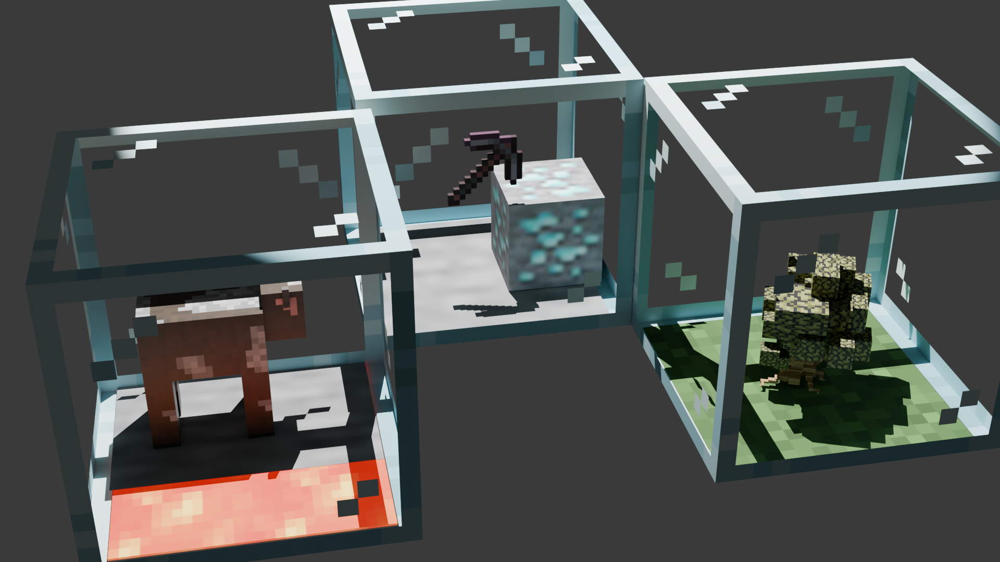

# Easy Farms

Three machines that farm almost everything in Minecraft: a **Resource Farm**, a **Plant Farm** and a **Mob Farm**.
What a farm produces is not baked into the block. You put items into it, and it matches them against data-driven
recipes. Swap the items, get a different result.

> Minecraft **1.21.1** · NeoForge **21.1.x** · Java 21 at runtime

> **Modpack authors and mod developers:** want to add your own ores, crops, mobs, tool tiers or upgrade cards?
> See the [Modpack author and modder guide](READMES/modpackauthors/README.md).

---

## The three farms

| Farm | What it does | Needs |
|---|---|---|
| **Resource Farm** | Mines blocks: stone, ores, wood, sand, nether blocks, and so on | A pickaxe, shovel or axe in the tool slot |
| **Plant Farm** | Grows crops, flowers, mushrooms, saplings and trees | Usually a hoe or axe, plus the plant (and soil) as inputs |
| **Mob Farm** | "Kills" mobs for their drops | A sword, plus the food or item that mob needs as input |

Each farm is a glass case that shows what it is doing: the block being mined with a tool swinging at it, the plant
growing, or the mob standing inside. The floor changes with the recipe: stone for the Resource Farm, grass, farmland
with water or soul sand for the Plant Farm, and lava with stone for the Mob Farm.

### Crafting

| Block | Recipe |
|---|---|
| Resource Farm | Glass panes around a **pickaxe** (any), over an **iron block** |
| Plant Farm | Glass panes around a **hoe** (any), over **dirt** |
| Mob Farm | Glass panes over a **lava bucket**, with a **sword** between two iron ingots below |

(Exact shapes are visible in JEI/EMI.)

---

## Using a farm

Right-click a farm to open its screen.

* **3 input slots.** The items the recipe is made of. For example, 2 porkchops makes a pig farm, and wheat seeds plus a hoe makes wheat.
* **1 tool slot.** The tool decides the speed and how long it lasts (see tiers below). Any pickaxe, shovel, axe, hoe or sword works, **including other mods' tools** such as AE2's quartz pickaxes: a tool is placed in a tier by its material, so you never need a recipe to "allow" a tool. The tool's enchantments count.
* **4 output slots.** Take-only. Hoppers and pipes can pull from them, and they can push into the inputs.
* **Upgrades button** (the left arrow in the top-right corner). Opens the Upgrades screen.

A farm only runs while its inputs and tool match a recipe **exactly**. Extra, unrelated items in the input slots mean
no match. Plant Farm recipes are slot-ordered: **soil in slot 1**, then the plant.

### The tool wears out, not the inputs

A farm does not use up its inputs every cycle, and for recipes that use a tool **the inputs are never used up**.
Instead the **tool wears out**. Its durability drains evenly while the farm runs, so the tool breaks (and only the tool
disappears) after a number of **Minecraft days of operation**:

* Base tier: **30 days** (configurable).
* The tool tier multiplies it: wood ×1, stone ×2, iron ×4, gold ×8, diamond ×16, netherite ×32.
* A tool that was already damaged breaks sooner, in proportion. A tool without durability is removed when the time is up.
* Recipes that need **no tool** (some Plant Farm and Mob Farm recipes) use up their **inputs** after that time instead.
* The **Infinity Upgrade** stops it completely: the tool never wears and the inputs are never used.

Only running time counts: a paused or blocked farm does not wear its tool. Put a new tool in and it starts its own
full lifetime. Jade, The One Probe and the farm's progress bar tooltip show how many days are left.

### Tool tiers

| Tier | Speed | Tool lifetime |
|---|---|---|
| Wood | slowest | ×1 |
| Stone | ×10 faster | ×2 |
| Iron | ×15 faster | ×4 |
| Gold | ×20 faster | ×8 |
| Diamond | ×25 faster | ×16 |
| Netherite | ×30 faster | ×32 |

Sword recipes (Mob and Plant Farms) have their own curve, taken from the original mods. **Efficiency** on a pickaxe,
shovel or axe, or **Sharpness** on a sword, shortens the work time further.

### Enchantments

Enchant the tool and the farm uses it:

* **Fortune** gives more drops on recipes that support it.
* **Silk Touch** gives the block itself on recipes that have a silk form (ores, glass, and so on).
* **Looting** (Mob Farm) gives more mob drops.
* **Fire Aspect** gives the cooked version of mob drops that have one.

### Upgrades

Upgrade cards go in the Upgrades screen. You can also **sneak and right-click the farm with a card in hand** to
install it.

| Card | Farms | Effect |
|---|---|---|
| **Redstone** | All | The farm only works while it has a redstone signal |
| **Smelter** | Resource | Drops come out smelted (ores to ingots, and so on) when the recipe allows it |
| **Speed** | Plant, Mob | Recipes that need no tool run much faster |
| **Nether** | Plant, Mob | Nether recipes run anywhere, not only in the Nether |
| **Infinity** | All | The tool never wears out and the inputs are never consumed |
| **Inscriber** | Resource | Emulates the AE2 Inscriber: farms that make AE2 items produce the processed form instead (see below) |

Cards are data-driven. A modpack or another mod can add more (see the modder guide).

### The Inscriber card

The Inscriber card does the AE2 Inscriber's job inside a farm:

* **Grinding:** with the card, a **Sky Stone** farm makes sky dust and a **Certus Quartz** farm makes certus quartz dust.
* **Pressing:** gold ore farms make **logic processor prints**, diamond ore farms **engineering processor prints** and the
  silicon farm **silicon prints**, but only with the matching **press** in the farm's **press slot**. The press slot
  is the last slot on the Resource Farm's Upgrades screen (hover it for a hint). The press is not consumed.

The Inscriber card is crafted with, and turns back into, an AE2 Inscriber, so it needs AE2 installed.

### Environments

Most recipes run anywhere. Nether recipes need either the **Nether Upgrade** or their real environment: blaze over
netherrack, nether wart over soul sand or soil, magma cubes over a magma block or lava, crimson and warped fungus
over their nylium, the other Nether mobs in the Nether dimension. The Shulker needs the End. If an environment is
missing, Jade and The One Probe tell you what the farm needs.

### Dye and sheep

Some recipes are **dyeable**: sheep, concrete, concrete powder and terracotta. Right-click the farm with a dye (or let
a **dispenser** fire dye at it) and the farm produces that colour. Dye is accepted even while the farm is idle, so
you can set it up first.

### Breaking a farm

* With **Silk Touch**, the farm drops as an item **with everything inside**: inputs, tool, outputs and upgrades.
* Otherwise the contents spill on the ground.

### Hoe and grass

Craft a **hoe with a grass block** to get farmland. The hoe loses 1 durability. Farmland is what the Plant Farm
shows for crops that need it.

---

## What can it farm?

* **Resource Farm:** every full block that can be mined with a pickaxe, shovel or hoe is auto-generated from the game's
  own block list, with drops read from vanilla loot tables, plus hand-made recipes for ores, logs, nether blocks and
  special cases. Silk-touch and smelted drops are covered. Budding amethyst can give any amethyst bud, or nothing.
* **Plant Farm:** crops, flowers, mushrooms, saplings and giant trees, nether wart, the nether fungi.
* **Mob Farm:** hostile, passive and Nether/End mobs. Inputs match the original Mob Farms mod
  (for example porkchops for pigs, raw beef for cows).

[//]: # (### The secret farm)

[//]: # ()
[//]: # (One recipe is not listed anywhere: the **Wither**. It needs **4 soul sand or soul soil, 2 nether stars and 3 wither)

[//]: # (skeleton skulls**, each stacked in its own slot, plus a sword. The recipe is hidden from JEI and EMI until you fill a)

[//]: # (farm with those inputs. That also unlocks the **UNLIMITED POWER!** advancement, and from then on the recipe shows)

[//]: # (in JEI and EMI. The Wither farm gives wither skeleton skulls and has a small chance at a nether star every cycle.)

---

## Compatibility

| Mod | Support |
|---|---|
| **JEI** | A category for each farm listing **every** recipe, with inputs, tool, drops and chances. The farms are the catalysts. |
| **EMI** | The same three categories, with the farms as workstations. |
| **Jade** | Shows the recipe progress, the tool, whether the environment is right, and days left on the inputs. |
| **The One Probe** | The same information as Jade. |
| **Applied Energistics 2** | Resource Farm recipes for certus quartz and charged certus quartz, fluix crystal and dust, silicon and silicon blocks, sky stone, flawed and flawless budding quartz, quartz glass, the mysterious cube, singularities and shattered singularities, and quantum-infused dust. The Inscriber card crafts to and from the AE2 Inscriber and grinds or presses these into dust and prints. |
| **ExtendedAE** | Entro blocks, crystals and dust, and silicon blocks. |
| **Advanced AE** | Quantum alloy, quantum-infused dust and shattered singularities. |
| **Integrated Dynamics** | Crystallized menril and chorus, their bricks and glass, and the menril tree on the Plant Farm. **Integrated Terminals** adds the glass variants. |

Recipes for other mods only load when that mod is installed. All the compat dependencies are **optional**: the mod
works with none of them.

Hoppers, pipes and any mod using the standard item handler capability can insert into the inputs and pull from the
outputs.

---

## Configuration

`config/easy_farms-common.toml`

| Option | Default | Meaning |
|---|---|---|
| `timeMultiplier` | `1.0` | Multiplies every farm's cycle time. `2.0` is twice as slow. |
| `baseInputLifetimeDays` | `30` | Minecraft days before the tool breaks (or, for toolless recipes, the inputs are used up) at the base tier. |

Tool tiers, recipes and upgrade cards are datapack data, so they can be changed without code. See the
[modder guide](READMES/modpackauthors/README.md).

---

## For players: quick start

1. Craft a **Resource Farm**.
2. Put a **coal ore** in an input slot and an **iron pickaxe** in the tool slot.
3. Watch the case. After a short time, coal appears in the outputs.
4. Open the Upgrades screen and add a **Smelter** card to smelt drops, or an **Infinity** card so the pickaxe never wears out.

---

## Building

Requires JDK 25 (the mod targets Java 21 bytecode). `./gradlew build`; `./gradlew runClient` for a dev client;
`./gradlew runData` for datagen. Optional content mods for testing (AE2 and friends) load in dev when
`with_content_mods=true` in `gradle.properties`.

## License

All Rights Reserved. Contact the author before redistributing.
